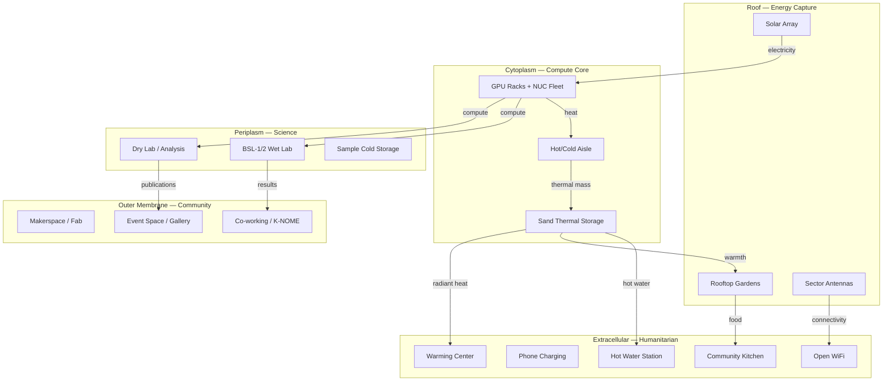

# Zoning and Zones — K-Derm Membrane Model at 464K SF

**Date**: Jul 20, 2026
**Status**: Concept — zone boundaries approximate until floor plans obtained
**Lineage**: gen5/foundations/KDERM_DIDERM_ENVELOPE → gen4/architecture/SOVEREIGN_HPC_EVOLUTION → 00_THE_SCUFFLE
**Wave**: 150

---

## Thesis

The ecoPrimals ecosystem uses a gram-negative cell membrane model (K-Derm)
to organize infrastructure: extracellular (internet), outer membrane (VPS),
periplasm (routing/bonding), inner membrane (firewall), cytoplasm (compute).
The same model maps onto the physical building.

The building is a cell. The roof is the extracellular surface (energy capture,
signal emission). The warehouse core is the cytoplasm (compute, thermal mass).
The lab spaces are the periplasm (science, conversion). The community rooms
are the outer membrane (interface with the neighborhood). The humanitarian
services are extracellular (no credentials, always available).

Zone boundaries follow the K-Derm membrane model, not arbitrary floor plans.

---

## Zone Architecture

```
┌─────────────────────────────────────────────────────────────────┐
│                    ROOF (Energy Capture Layer)                   │
│                                                                  │
│   Solar Array          Rooftop Gardens       Sector Antennas     │
│   (~464K SF flat       GPU-warmed cold       Neighborhood mesh   │
│    industrial roof     frames & raised       supernode: 3-sector │
│    ideal for panels)   beds, rain capture    coverage of Old     │
│                                              Everett rectangle   │
│   ──────────── ↓ electricity ↓ food ↓ signal ──────────────     │
└─────────────────────────────────────────────────────────────────┘

┌─────────────────────────────────────────────────────────────────┐
│              CYTOPLASM (Compute Core — Interior Bays)            │
│                                                                  │
│   GPU Racks              Sand Thermal Storage    Hot/Cold Aisle  │
│   Consumer + HBM2        Warehouse bays =        Tall ceilings   │
│   fleet, NUC intake,     sand batteries          enable proper   │
│   NPU substrate          ($10/kWh thermal)       airflow mgmt    │
│                                                                  │
│   Heavy power throughout. Industrial ceilings (10-14 ft).        │
│   ──────────── ↓ heat ↓ data ↓ thermal mass ────────────────    │
└─────────────────────────────────────────────────────────────────┘

┌─────────────────────────────────────────────────────────────────┐
│              PERIPLASM (Science — Dedicated Spaces)              │
│                                                                  │
│   BSL-1 Wet Lab          Dry Lab / Analysis     Cold Storage     │
│   ABG bench work,        Workstations,          -80°C freezer,   │
│   wetSpring metagen,     data viz, paper        sample archive   │
│   airSpring soil         writing, helixVision                    │
│                                                                  │
│   bench → sample → sequencer → nestGate CAS → spring validation │
│   ──────────── ↓ results ↓ publications ────────────────────    │
└─────────────────────────────────────────────────────────────────┘

┌─────────────────────────────────────────────────────────────────┐
│            OUTER MEMBRANE (Community — Interface Spaces)         │
│                                                                  │
│   Makerspace / Fab       Co-working / K-NOME    Event Space     │
│   3D printers, CNC,     Mentoring rooms,        Gallery, talks, │
│   electronics bench      ABG meetings,           community       │
│                          citizen science          events          │
│                                                                  │
│   Open to community with membership / reservation.               │
│   ──────────── ↓ engagement ↓ mentoring ↓ culture ──────────   │
└─────────────────────────────────────────────────────────────────┘

┌─────────────────────────────────────────────────────────────────┐
│         EXTRACELLULAR (Humanitarian — No Credentials)           │
│                                                                  │
│   Hot Water Station      Phone Charging         Open WiFi       │
│   24/7, GPU-heated,      USB ports, always      Mesh AP, no     │
│   no credentials         available              subscription,   │
│                                                  no harvesting   │
│                                                                  │
│   Warming Center         Community Kitchen                       │
│   Sand battery           Low-barrier, food                       │
│   discharge in winter    from rooftop gardens                    │
│                                                                  │
│   Street-accessible. No membership. No ID. No credentials.      │
└─────────────────────────────────────────────────────────────────┘
```

---

## Zone Flow Diagram



---

## Building Structure and Zone Assignment

From the Martin Commercial offering memorandum, the building has two
distinct structural sections:

### Three-Floor Section (South Side) — 348,000 SF

| Floor | Area | Clear Height | Proposed Zone |
|-------|------|-------------|---------------|
| 1st floor | 116,000 SF | 10'10" / 13.5' to deck | **Outer membrane + Extracellular** — community, humanitarian (street-level access) |
| 2nd floor | 116,000 SF | 10'10" / 13.5' to deck | **Periplasm** — wet lab, dry lab, makerspace, co-working |
| 3rd floor | 116,000 SF | 10'10" / 13.5' to deck | **Cytoplasm (compute)** — 9 rooms with 400A/480V + 35-ton HVAC each |

The 3rd floor is the compute zone. The cannabis grow operation built
exactly what GPU compute needs: 9 individually powered and cooled rooms,
each ~3,162 SF with dedicated 400A/480V circuits and 35-ton HVAC.

### Single-Floor Section (North Side) — 102,795 SF

| Area | Clear Height | Bay Size | Proposed Zone |
|------|-------------|----------|---------------|
| 102,795 SF | **14'7"** | 55' x 18' | **Cytoplasm (thermal)** — sand storage bays, heavy compute, cold storage |

The north section's 14'7" clear height and 55' bays are ideal for
sand thermal storage (volumetric heat storage needs vertical space)
and tall compute rack installations with proper hot/cold aisle.

### Mezzanine — ~8,250 SF

| Dimensions | Proposed Zone |
|-----------|---------------|
| 250' x 33' | **Periplasm (observation)** — dry lab, data analysis, overlooking north section |

### 3rd Floor Room Layout (Pre-Built Compute Cells)

| Room | Dimensions | SF | Power | HVAC | Zone Role |
|------|-----------|-----|-------|------|-----------|
| 301 | 53'-7" x 59' | 3,162 | 400A/480V | (3) 20T Lennox | Compute pod |
| 302 | 53'-7" x 59' | 3,162 | 400A/480V | (3) 20T Lennox | Compute pod |
| 303 | 53'-7" x 59' | 3,162 | 400A/480V | (2) 35T Daikin | Compute pod |
| 304 | 71'-7" x 59' | 4,224 | 400A/480V | (2) 50T Daikin | **Beachhead** (largest room) |
| 305 | 53'-7" x 59' | 3,162 | 400A/480V | (2) 35T Daikin | Compute pod |
| 306 | 71'-7" x 49'-2" | 3,520 | 400A/480V | (2) 35T Daikin | Compute pod |
| 307 | 53'-7" x 59' | 3,162 | 400A/480V | (2) 35T Daikin | K-NOME / community compute |
| 308 | 53'-7" x 59' | 3,162 | 400A/480V | (2) 35T Daikin | Reserved (Year 2+) |
| 309 | 53'-7" x 59' | 3,162 | 400A/480V | (2) 35T Daikin | Reserved (Year 2+) |
| Electrical Rm | — | — | 8 MW switchgear | (1) 15T Daikin | Infrastructure |
| Harvest Rm | — | — | — | (1) 15T Daikin | Storage / staging |

Each room is a self-contained compute cell: its own power, its own
cooling, its own walls. The cannabis industry solved the power-density
and per-room isolation problem.

---

## Zone Sizing Estimates

At full campus scale (years 3-5), approximate zone allocations for
a 50,000-100,000 SF footprint:

| Zone | % | Area (at 50K SF) | Priority |
|------|---|-----------------|----------|
| Cytoplasm (compute core) | 30% | 15,000 SF | Year 1 |
| Periplasm (science) | 20% | 10,000 SF | Year 2 |
| Outer membrane (community) | 20% | 10,000 SF | Year 2 |
| Extracellular (humanitarian) | 15% | 7,500 SF | Year 1 (minimal) |
| Sand thermal storage | 10% | 5,000 SF | Year 3 |
| Circulation / utility | 5% | 2,500 SF | Throughout |

At beachhead scale (Year 1, 1-2K SF), all zones collapse into one room:
a compute rack, a bench, a charging station, and an open WiFi AP.
Differentiation happens as square footage grows.

---

## Membrane Permeability

K-Derm zones are not hard walls. They are membranes with controlled
permeability:

| Boundary | Permeability | Control |
|----------|-------------|---------|
| Extracellular → Outer membrane | High | Membership, reservation |
| Outer membrane → Periplasm | Medium | Lab safety training, PPE |
| Periplasm → Cytoplasm | Low | Authorized operators only |
| Cytoplasm → Roof | Maintenance | Scheduled access |
| Extracellular → Humanitarian | **Open** | No credentials. Always. |

The humanitarian zone is maximally permeable by design. Hot water,
charging, WiFi, and warmth flow outward without authentication. This is
not a security gap — it is the architecture.

---

## footPrint Integration

Each zone maps to a polygon layer in footPrint:

- Base layer: building footprint from parcel boundary (FetchGIS / satellite)
- Zone overlays: colored polygons for each K-Derm zone
- Flow arrows: energy, data, heat, food, water routing between zones
- Sensor grid (future): ESP32/airSpring placement within zones

As floor plans become available, zones refine from building-level
to suite-level to room-level.

See `PROPERTY_PROFILE.md` for floor plan sourcing strategy.
